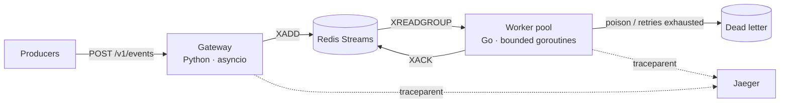

# PulseBridge

**A high-throughput event bridge, built to be argued with.**

A Python asyncio gateway accepts events over HTTP and publishes them to Redis
Streams. A Go worker pool consumes them with at-least-once delivery, bounded
retries, dead-lettering, and recovery from consumer death. Both sides are traced
end to end, measured, and covered by tests that exercise the failure paths rather
than the happy one.

[](https://github.com/maksimvasilenko/pulsebridge/actions/workflows/ci.yml)


> Most portfolio repositories show a system working. This one is about what
> happens when it doesn't: a consumer killed mid-flight, a publish that fails
> after the idempotency claim, a message that can never be parsed, a burst past
> capacity. Each of those has a mechanism, a test, and a documented decision.

---

## The 60-second version



| | |
|---|---|
| **Guarantee** | At-least-once, closed to effectively-once by an idempotent handler |
| **On consumer death** | Stale pending entries reclaimed by a surviving replica |
| **On repeated failure** | Bounded retries, then quarantine with full replay context |
| **On overload** | Degrades into queueing — measured: no 5xx, no data loss |
| **Measured knee** | ~500 rps per gateway process, p99 under 50 ms to ~400 rps |
| **Tracing** | One trace spans HTTP request → Redis → Go handler |

---

## Try it

```bash
docker compose up -d --build
```

| | |
|---|---|
| Gateway | http://localhost:8080/docs |
| Grafana | http://localhost:3000 — "PulseBridge — ingest & consumption" |
| Jaeger | http://localhost:16686 |
| Prometheus | http://localhost:9090 |

Send an event, then replay it:

```bash
curl -s localhost:8080/v1/events \
  -H 'content-type: application/json' \
  -d '{"tenant_id":"acme","event_type":"order.created","payload":{"id":"1"},"event_id":"evt-1"}'
# {"event_id":"evt-1","stream_id":"1785749158267-0","status":"accepted"}   HTTP 202

# same request again
# {"event_id":"evt-1","stream_id":"","status":"duplicate"}                 HTTP 200
```

### Watch the dead-letter path work

Write a malformed entry straight to the stream, bypassing the gateway's
validation:

```bash
docker compose exec redis redis-cli XADD pulsebridge.events '*' \
  tenant_id acme event_type order.created payload '{"broken"'

# within one poll cycle
docker compose exec redis redis-cli XRANGE pulsebridge.events.dlq - +
# ... dlq_reason=undecodable, dlq_error=missing required field: event_id,
#     dlq_original_id, plus every original field, preserved for replay

docker compose exec redis redis-cli XPENDING pulsebridge.events pulsebridge-workers
# 0  — quarantined, not left to retry forever
```

### See one trace cross both languages

Open Jaeger, pick service `pulsebridge-worker`, open a trace. It contains the
gateway's `POST /v1/events` span and the worker's `pulsebridge.events process`
span, linked by a `traceparent` carried on the stream entry.

### No Docker

```bash
cd services/gateway
uv sync
PULSEBRIDGE_USE_MEMORY=true uv run uvicorn pulsebridge_gateway.api.main:app --port 8080
```

---

## What is actually interesting here

### 1. Reclaim, not just retry

`XREADGROUP` hands a message to exactly one consumer. If that consumer is
OOM-killed between the read and the acknowledgement, the entry sits in the
pending list forever, and no amount of scaling brings it back. Not acknowledging
on failure is necessary but not sufficient — something has to notice.

A reclaim loop lists stale pending entries and takes them over. The idle window
is enforced to be at least twice the handler timeout, because a shorter window
means every slow-but-successful event gets processed twice by the mechanism meant
to protect it.

Verified by `SIGKILL` rather than by unit test — a graceful drain proves nothing
about crash recovery. One replica was killed outright under 600 rps; the survivor
reclaimed the stranded entry, and the final accounting across the session was
**27 003 applied + 1 dead-lettered = 27 004 written, 0 pending**. Nothing lost,
and nothing double-applied.

→ [`consumer.go`](services/worker/internal/consumer/consumer.go) · [ADR 0004](docs/adr/0004-dead-letter-and-retries.md) · [the run](docs/benchmarks.md#killing-a-worker-mid-load)

### 2. A bug the rewrite found

The gateway claimed the idempotency key **before** publishing, and did not
release it if the publish failed. Every retry of that event id then returned
`200 duplicate` — for an event that was never written. The event was gone, for
the full 24-hour TTL, with no error anywhere.

The claim still has to come first, or two concurrent requests with the same id
both publish. So the fix is a rollback on failure, plus a `503` that says
honestly that nothing was accepted.

→ [`ingest.py`](services/gateway/src/pulsebridge_gateway/application/ingest.py) · [ADR 0006](docs/adr/0006-idempotency-rollback.md)

### 3. A benchmark that was measuring itself

The original Python benchmark reported ~350 rps. A control run against a bare
FastAPI app with a one-line handler produced the same number from the same
client: the asyncio load generator was saturating its own event loop long before
the gateway was near its limit.

Replaced with k6. The real curve shows a knee at ~500 rps per process, clean
degradation into queueing past it, and 2.4x throughput from four processes.

→ [`benchmarks.md`](docs/benchmarks.md)

### 4. Overload behaviour, changed because it was measured

The first overload run returned 72 responses with HTTP 503, logged as
`Too many connections`: the default Redis pool rejects instantly when exhausted,
milliseconds before a connection would have freed up. Switching to a blocking
pool with a bounded timeout absorbed the burst.

Every run afterwards — including the same overload — completed with **zero 5xx**.
The bound is still a bound: past the timeout, requests fail fast rather than
queueing without limit.

### 5. At-least-once, said out loud

No claim of exactly-once. A handler that succeeds and then fails to acknowledge
will be redelivered no matter how careful the consumer is, so the gap is closed
where it can be: the handler claims each event id atomically before applying its
effect, and releases the claim if the effect fails — otherwise the retry is
mistaken for a duplicate and the event is silently dropped.

→ [ADR 0005](docs/adr/0005-at-least-once-semantics.md)

---

## Measured

Apple M1 Max, full compose stack, k6 driving load, 30 s steady state. Load
generator, Redis and both workers share the same 10 cores — these are capacity
numbers for one laptop, not a production claim.

| Offered rps | Achieved | 5xx | p50 | p95 | p99 |
|---:|---:|---:|---:|---:|---:|
| 100 | 100.0 | 0 | 2.5 ms | 4.2 ms | 10.6 ms |
| 400 | 400.0 | 0 | 2.0 ms | 14.3 ms | 36.7 ms |
| 500 | 500.0 | 0 | 2.6 ms | 26.9 ms | 61.8 ms |
| 600 | 599.9 | 0 | 8.4 ms | 74.4 ms | 209.5 ms |
| 800 | 532.6 | 0 | 1 566 ms | 14 154 ms | 17 442 ms |

Consumption was never the constraint: two Go replicas processed **258 510
events** across these runs, split 50.1% / 49.9% without coordinating, at a mean
handler latency of **0.379 ms**, leaving the pending list empty even during the
overload run.

Under fault injection — one replica `SIGKILL`ed mid-load — every event written to
the stream was still accounted for exactly once:

| Written | Applied | Dead-lettered | Pending |
|---:|---:|---:|---:|
| 27 004 | 27 003 | 1 | 0 |

Full method, environment and caveats: [`benchmarks.md`](docs/benchmarks.md).

---

## Documentation

| | |
|---|---|
| [Architecture](docs/architecture.md) | Components, ingest and consumption paths, failure-mode table |
| [Benchmarks](docs/benchmarks.md) | Method, capacity curves, what the numbers do not mean |
| [SLOs](docs/slo.md) | Objectives, error budgets, and what does *not* count as a failure |
| [Runbook](docs/runbook.md) | One section per alert: impact, diagnosis, action |
| [High-load readiness](docs/high-load.md) | Implemented vs. what production still needs |
| [ADRs](docs/adr/) | Seven decisions, each with the alternatives that were rejected |

---

## Testing

```bash
make test              # Go + Python unit tests
make test-integration  # adds a real Redis
make lint              # ruff, mypy --strict, go vet, gofmt
make load              # k6 against the running stack
```

| | |
|---|---|
| Go | Race-enabled — all three loops share one worker pool, so `-race` is not optional. Reclaim, retry-budget, dead-letter and drain-on-shutdown paths run against miniredis, so CI needs no container. |
| Python | In-memory adapters for speed; a real Redis for what fakes cannot prove — Lua atomicity, `SET NX` under concurrency, and the exact stream field layout the Go worker parses. |
| Contracts | The published JSON Schema and the committed OpenAPI spec are asserted against the code, so neither can drift silently. CI fails on a stale spec. |
| Stack | CI runs `docker compose up` and asserts the real thing end to end: an event is accepted, a replay returns `duplicate`, the worker applies it, and a poison message reaches the dead-letter stream. |

Coverage, by package rather than as one flattering average:

| | |
|---|---|
| `domain` 100% · `config` 95.5% · `processor` 93.0% · `consumer` 82.2% · `dlq` 77.8% | Go, logic packages |
| `cmd/worker`, `metrics`, `telemetry` — 0% | wiring, covered by the compose smoke test instead |
| 84% | Python gateway |

The tests worth reading are the ones named after failures:
`TestReclaimRetriesStaleMessage`, `TestReclaimSkipsMessagesInsideTheIdleWindow`,
`TestDeadLetterFailureKeepsMessagePending`,
`TestRunDrainsInFlightWorkOnShutdown`,
`test_failed_publish_releases_the_idempotency_claim`.

---

## Layout

```
pulsebridge/
├── services/
│   ├── gateway/          Python · FastAPI · hexagonal (domain → application → infrastructure → api)
│   └── worker/           Go · consumer, reclaim, dead-letter, telemetry
├── contracts/            JSON Schema + committed OpenAPI spec
├── deploy/               Prometheus scrape + alert rules, provisioned Grafana
├── docs/                 architecture, benchmarks, SLOs, runbook, ADRs
├── scripts/              OpenAPI export, k6 load profile, smoke benchmark
└── docker-compose.yml    Redis · gateway · 2 workers · Prometheus · Grafana · Jaeger
```

---

## API

`POST /v1/events`

```json
{
  "tenant_id": "acme",
  "event_type": "order.created",
  "payload": { "order_id": "o-1" },
  "event_id": "optional-client-id",
  "correlation_id": "optional-trace"
}
```

| Code | Meaning |
|---|---|
| `202` | Durably in the stream. Never returned for anything less. |
| `200` | Replay of an event already accepted. Success, not an error. |
| `429` | Over quota, with `Retry-After`. |
| `422` | Envelope violates the contract. |
| `503` | Not written. Retry. |

Also `GET /healthz` (liveness, never touches Redis), `GET /readyz` (readiness,
`503` while draining), `GET /metrics`.

Full spec: [`contracts/openapi.json`](contracts/openapi.json) · Envelope
contract: [`contracts/events.schema.json`](contracts/events.schema.json)

---

## License

MIT — see [LICENSE](LICENSE).

### Author

Maksim Vasilenka — backend engineer (Python · Go · distributed systems ·
high-stakes integrations).
