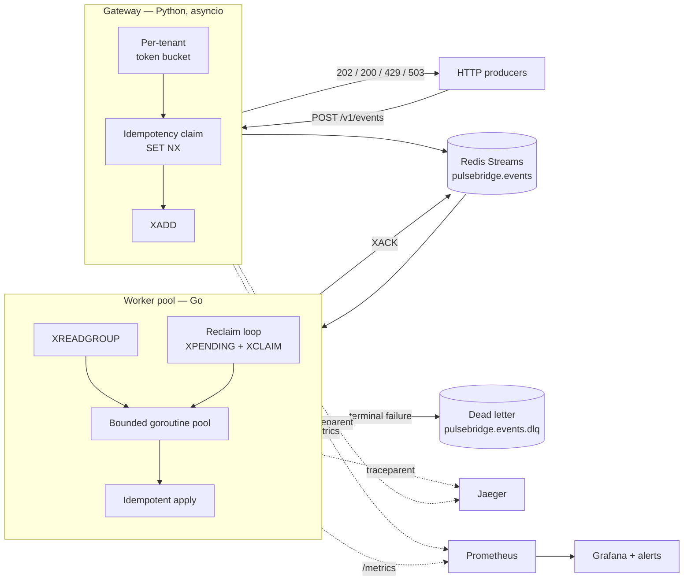
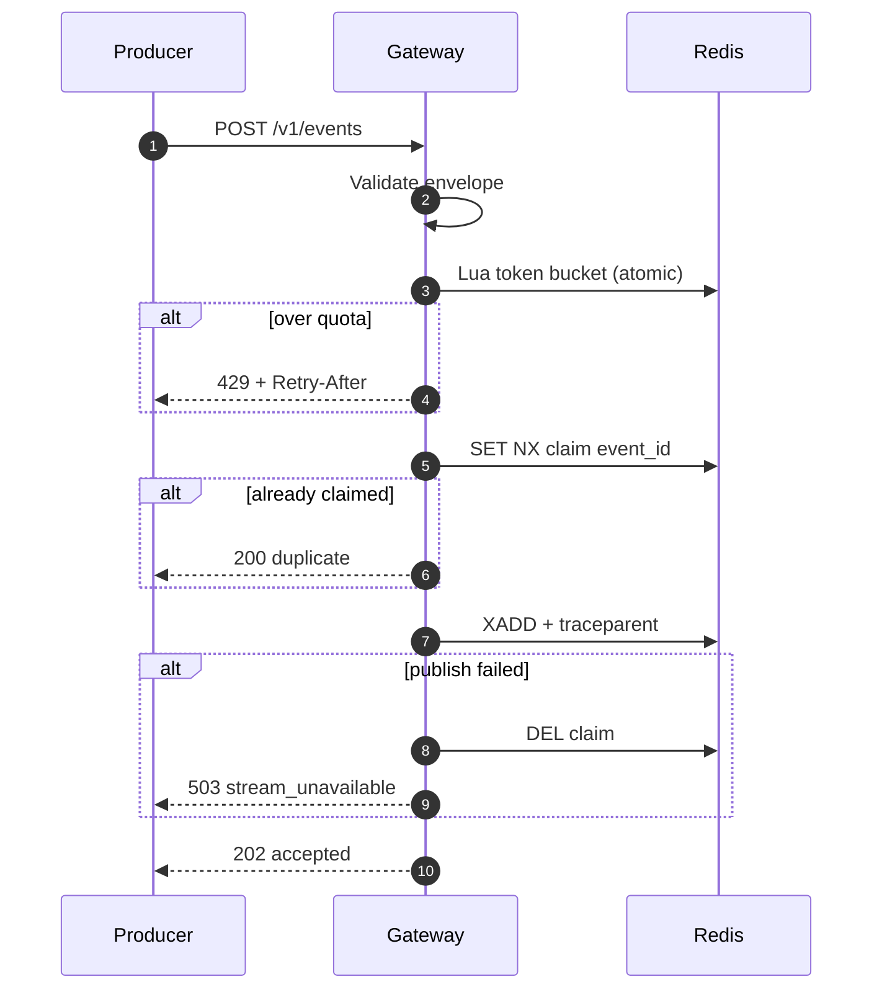
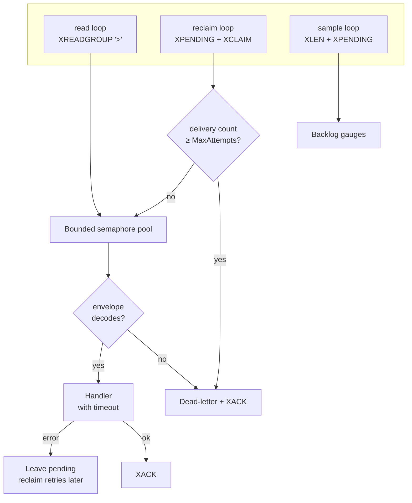

# Architecture

PulseBridge decouples event producers from event processing. Producers get a
fast, bounded write that either succeeds durably or fails honestly; processing
happens behind a durable log, at whatever rate consumers can manage.

Everything below is about one question: **what happens when a step fails.** The
happy path is three lines of code; the design is the rest.

---

## Components



| | Gateway | Worker |
|---|---|---|
| Language | Python 3.11+, asyncio | Go 1.25 |
| Role | Admission control and durable handoff | Consumption and side effects |
| Scaling | Stateless; scale by process or replica | Consumer group; scale by replica |
| Bottleneck | One event loop, three Redis round trips per request | Handler cost × concurrency |

### Why two languages

Not for variety. The two halves have genuinely different profiles.

The gateway is I/O-bound: it waits on Redis and does almost no computation.
Python's asyncio handles that well, and FastAPI plus Pydantic gives validation
and a generated OpenAPI spec at no cost.

The worker is concurrency-bound: thousands of in-flight units, each cheap, each
needing an independent timeout and cancellation. Goroutines are a better fit than
a thread pool or an event loop, and the runtime schedules them across cores
without the GIL question arising.

The seam between them is a wire contract
([`../contracts/events.schema.json`](../contracts/events.schema.json)), not a
shared library, which is what makes the split viable rather than merely fashionable.

---

## Ingest path



**The step order is the design.**

Rate limiting runs first so a tenant flooding the endpoint is rejected before it
can consume Redis writes. A throttled request leaves no trace at all — important,
because a client that backs off and retries the same `event_id` must not then be
told it is a duplicate of an event that was never accepted.

The idempotency claim runs **before** the publish, not after. Claiming afterwards
leaves a window where two concurrent requests carrying the same id both publish.
The cost of claiming first is that a failed publish has to give the claim back —
see [ADR 0006](adr/0006-idempotency-rollback.md) for the bug that existed before
it did.

The response codes are load-bearing:

| Code | Meaning |
|---|---|
| `202` | Durably in the stream. Never returned for anything less. |
| `200` | Replay of an event already accepted. Success, not an error. |
| `429` | Over quota, with `Retry-After`. A deliberate answer. |
| `422` | Envelope violates the contract. |
| `503` | Not written. Retry. |

---

## Consumption path

Three loops share one bounded worker pool.



**The read loop** pulls entries never delivered to the group. Simple, and it
covers only the case where nothing has gone wrong.

**The reclaim loop** is what makes at-least-once real. `XREADGROUP` hands a
message to exactly one consumer; if that consumer is OOM-killed between the read
and the ack, the entry sits in the pending list forever and no amount of scaling
brings it back. The reclaim loop finds entries idle beyond a threshold and takes
them over.

The idle threshold is enforced to be at least twice the handler timeout. Reclaim
faster than a handler can finish, and every slow event gets processed twice by
the mechanism meant to protect it.

**The sample loop** exports backlog gauges. It exists because depth alone is a
bad signal — a healthy consumer under load always has entries in flight. Age is
the signal that distinguishes *behind* from *stuck*, and it is what
`ConsumerBacklogStuck` alerts on.

### Back-pressure

The pool is a buffered channel sized to `Concurrency`. When it is full,
`dispatch` blocks, the read loop stops pulling, and the backlog accumulates in
Redis rather than in the worker's heap.

That is the whole mechanism, and the property that matters is where the queue
lives: a bounded in-memory buffer would turn a traffic spike into an OOM kill,
which loses the in-flight messages. Letting the stream hold the backlog means a
spike costs latency instead of data.

### Graceful shutdown

On `SIGTERM` the loops stop reading, readiness flips to `503` so orchestrators
stop routing, and in-flight handlers are given their full timeout to finish —
their context is deliberately detached from the shutdown signal. `Run` returns
only after they have drained.

The ordering matters because acknowledgement happens *after* the handler returns.
Cutting handlers off at shutdown would leave completed work unacknowledged, and
the next process would redo it.

---

## Failure modes

| Failure | What happens | Recovery |
|---|---|---|
| Duplicate submissions | Claimed once at ingest; handler claims again before applying | Automatic, both layers |
| Producer floods one tenant | Per-tenant bucket throttles that tenant only | Automatic; blast radius contained |
| Publish fails | Claim released, `503` returned | Producer retries |
| Handler fails | Not acknowledged, stays pending | Reclaimed and retried up to `MaxAttempts` |
| Consumer dies mid-flight | Entry stays pending, owned by a dead consumer | Reclaimed by a surviving replica |
| Malformed entry | Quarantined on first attempt | Manual: inspect the DLQ |
| Retry budget exhausted | Quarantined with the last error | Manual: fix the cause, then replay |
| Dead-letter write fails | Message left pending, counter increments, pages | Manual: this is the only path to data loss |
| Handler succeeds, ack fails | Redelivered | Handler's claim absorbs it as a duplicate |
| Redis unavailable | Ingest returns `503`; workers retry their loops | Automatic once Redis returns |
| All workers down | Stream buffers to `StreamMaxLen`, then trims oldest | Restart before the buffer fills |

The last row is the real deadline. Retention is a bound, and past it the system
does drop data — deliberately, to avoid unbounded memory growth, and visibly,
through the stream length gauge.

---

## Layering in the gateway

```
domain/          EventEnvelope, ports, errors        — no framework imports
application/     IngestEventUseCase                  — orchestration only
infrastructure/  Redis + in-memory adapters          — all I/O
api/             FastAPI routes, middleware, DI      — thin HTTP shell
```

Dependencies point inwards. `domain` imports nothing from the layers above it,
which is checked by the fact that the entire use case can be tested with
in-memory adapters and no Docker.

That is the practical payoff rather than an architectural principle: the unit
suite runs in under a second, and the Redis-specific behaviour that fakes cannot
prove — Lua atomicity, `SET NX` under concurrency, the exact field layout the Go
worker parses — gets its own integration suite against a real Redis.

---

## Deliberate omissions

Everything here is a demo boundary, chosen so the repository stays reviewable in
one sitting. Named rather than hidden:

* **No authentication.** A real edge needs mTLS or signed tokens per tenant.
* **No schema registry.** One JSON Schema file, versioned in git. Adequate for
  one producer, not for many.
* **No sampling on traces.** Fine at demo volume, not at production volume.
* **The handler's side effect is a counter.** Real handlers write to a database
  or call an API, and that cost dominates every number in
  [`benchmarks.md`](benchmarks.md).
* **Redis is a single node.** Production needs Sentinel or Cluster, and AOF is
  not optional.

The production path for each of these is in [`high-load.md`](high-load.md).
