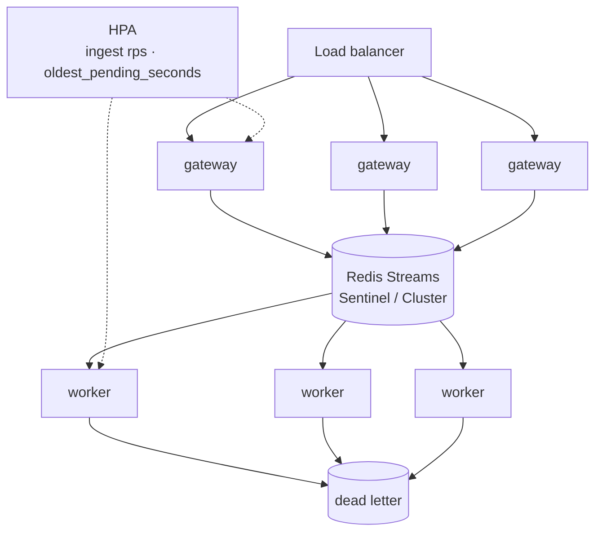

# High-load readiness

What is implemented, what the measurements say, and what a production deployment
would still need. The gap is named rather than hidden — an honest list of
omissions is more useful to a reviewer than a checklist of ticked boxes.

---

## Implemented

### Admission control

* Per-tenant token bucket in atomic Lua. One tenant cannot exhaust another's
  quota, and the read-modify-write of the bucket is a single server-side step,
  so replicas do not double-count refills.
* Bounded, blocking Redis connection pool. Overload becomes a short wait and then
  a fast failure rather than unbounded connection growth. This was changed after
  measurement: the non-blocking pool produced 72 spurious 503s during an overload
  run, and the blocking pool produced none. See
  [`benchmarks.md`](benchmarks.md#a-measured-fix-connection-pool-behaviour-under-overload).
* Approximate `MAXLEN` trim on the stream, so a stalled consumer cannot grow
  Redis memory without bound.
* Idempotency claim with rollback, so a failed publish never leaves an event
  permanently marked as a duplicate ([ADR 0006](adr/0006-idempotency-rollback.md)).

### Delivery guarantees

* At-least-once, stated explicitly, closed by an idempotent handler
  ([ADR 0005](adr/0005-at-least-once-semantics.md)).
* Reclaim of stale pending entries, so a consumer killed mid-flight does not
  strand its messages.
* Bounded retries with a dead-letter stream that preserves the original envelope
  for replay ([ADR 0004](adr/0004-dead-letter-and-retries.md)).
* Back-pressure through a bounded worker pool: the backlog accumulates in Redis,
  not in the worker's heap.
* Graceful shutdown that drains in-flight handlers before exiting, so completed
  work is acknowledged rather than redone.

### Observability

* Prometheus metrics on both services, including backlog depth **and age** —
  the latter is what distinguishes "behind" from "stuck".
* Distributed tracing across Python → Redis → Go via W3C `traceparent` on the
  stream entry ([ADR 0007](adr/0007-distributed-tracing.md)).
* Structured JSON logs on both sides, with a correlation id bound per request.
* Nine alert rules, each mapped to a section of [`runbook.md`](runbook.md).
* A provisioned Grafana dashboard ordered the way an on-call engineer reads it.

### Verification

* Go unit and integration tests, race-enabled, covering the reclaim, retry and
  dead-letter paths against miniredis.
* Python unit tests against in-memory adapters, plus an integration suite against
  a real Redis for the behaviour fakes cannot prove.
* Contract tests binding the published JSON Schema and the committed OpenAPI spec
  to the code, so neither can drift silently.
* A k6 load profile with thresholds derived from the objectives in
  [`slo.md`](slo.md), so a regression fails the run.

---

## Measured limits

From [`benchmarks.md`](benchmarks.md), on one laptop with the load generator
sharing the machine:

| | |
|---|---|
| Single gateway process | ~500 rps knee; p99 under 50 ms to ~400 rps |
| Four gateway processes | ~2.4x throughput; 800 rps at a p99 of 30.7 ms |
| Worker handler | 0.379 ms mean; 96.4% under 1 ms |
| Two worker replicas | Split work 50.1% / 49.9% with no coordination |
| Behaviour past capacity | Degrades into queueing; no 5xx, no data loss |

The gateway is the bottleneck, and it is bottlenecked on a single Python event
loop making three Redis round trips per request. That is the number to scale on,
and CPU utilisation is not.

---

## Production checklist

Ordered by what would break first under real traffic.

| Area | Status | What production needs |
|---|---|---|
| Redis availability | Single node | Sentinel or Cluster; AOF mandatory; the DLQ stream must not be evictable |
| AuthN / AuthZ | None | mTLS or signed tokens at the edge, tenant scope in claims |
| Broker | Redis Streams | Kafka or Redpanda for multi-AZ durability and long replay windows ([ADR 0002](adr/0002-redis-streams-bridge.md)) |
| Handler | Counter projection | A real downstream; its latency dominates every number above |
| Autoscaling | Manual | HPA on ingest rps and on `pulsebridge_worker_oldest_pending_seconds` — scale on backlog age, not depth |
| Trace sampling | Trace everything | Head or tail sampling; tracing every event does not survive production volume |
| Schema evolution | One JSON Schema in git | A registry with compatibility checks once there is more than one producer |
| Retry backoff | Fixed interval | Exponential backoff, which Redis Streams cannot express natively ([ADR 0004](adr/0004-dead-letter-and-retries.md)) |
| Chaos testing | Not automated | Kill the Redis primary and a mid-flight consumer under load; assert no silent drop |
| Secrets | Environment variables | A secret manager, and no Redis URL with credentials in an env var |
| Multi-region | Single region | Answer the ordering question before the replication one |

---

## Scaling shape

Both tiers scale horizontally without coordination. The gateway holds no local
state, and both the rate limiter and the idempotency store are atomic in Redis.
The workers share one consumer group, so Redis distributes entries between them —
demonstrated in the benchmark by two replicas splitting 258 510 events almost
exactly in half without being told anything about each other.

Scale each tier on a different signal. The gateway scales on ingest rate against
the measured knee. The workers scale on backlog **age**, because a healthy
consumer under load always has a non-empty pending list, and scaling on depth
would add replicas that are not needed.

---

PulseBridge stays deliberately small so the whole design can be read in one
sitting. The aim is not to be a production system, but to be honest about the
distance between this and one — and to have measured that distance rather than
estimated it.
